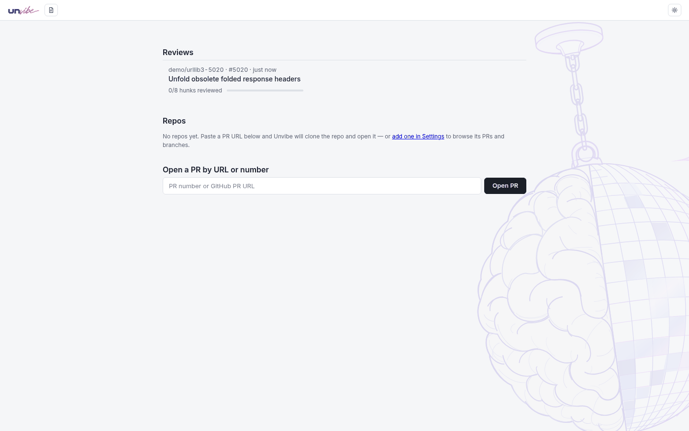
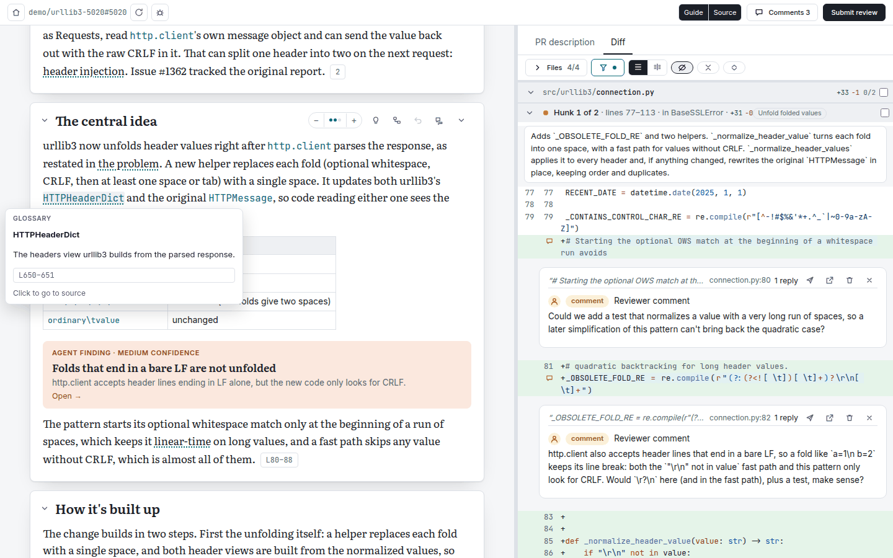
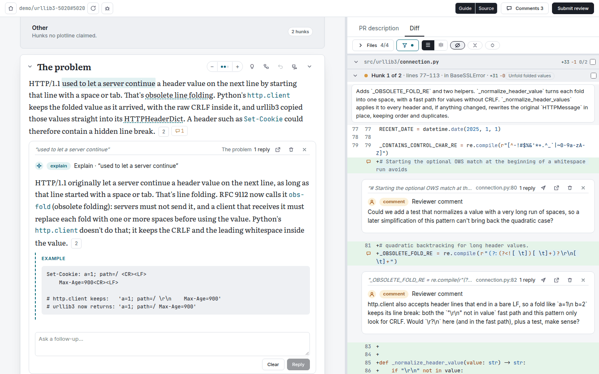
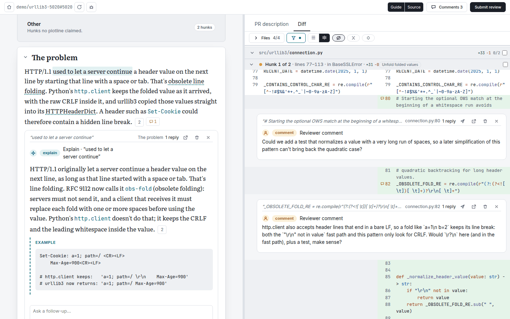
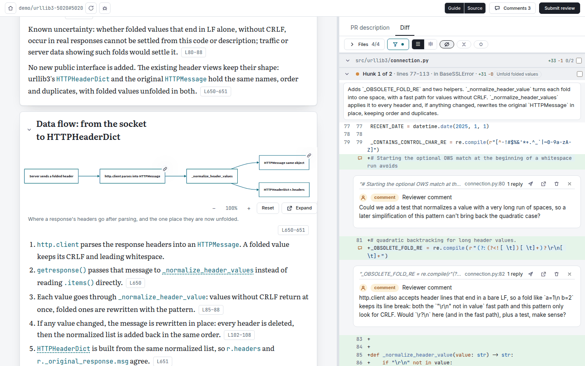
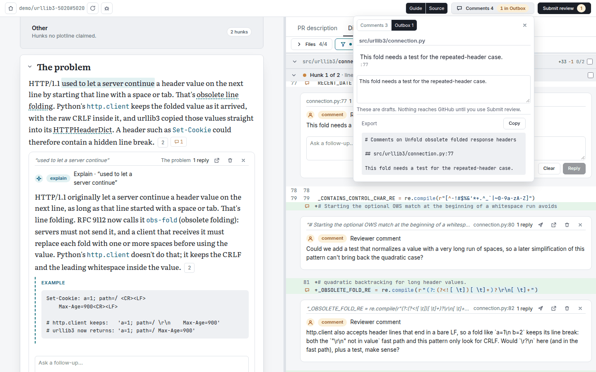
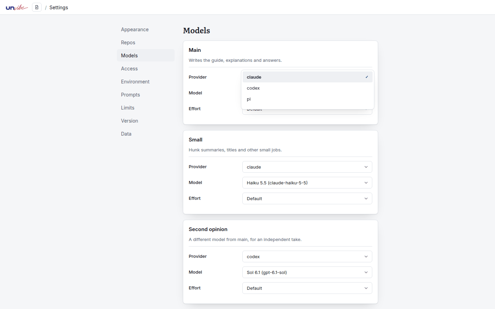

# Unvibe

Unvibe reads a branch or pull request with you. It restates the change as a guide with links to the exact code, shows the diff beside it, answers questions anchored to the text, and submits review comments to GitHub when you choose.


## Status

Unvibe runs on Linux and macOS, on your machine, under your own logins. The front-door page is [www.romansix.org/unvibe](https://www.romansix.org/unvibe/); open work is tracked at [github.com/indigoviolet/unvibe/issues](https://github.com/indigoviolet/unvibe/issues).

## Requirements

Node 24 or newer, `git`, and `gh` logged in (needed for PRs and submitting; local branches work without it). For the guide itself, the `claude` and/or `codex` CLIs installed and logged in. Unvibe uses those logins and does not install the CLIs for you. Minimum versions: Codex 0.160.1, Claude Code 2.1.293. Optional: `pi` (1.4.0 or newer) — when a `pi` binary is present Unvibe detects it and offers it as a third provider, with the models your `pi` offers; without it nothing changes. Diagrams in the guide are drawn by the `d2` program (0.9.0 or newer; `brew install d2`, or see d2lang.com); without it everything else works and diagrams show as their source text.

## Try it without installing

```sh
npx github:indigoviolet/unvibe#release doctor
npx github:indigoviolet/unvibe#release start   # prints your private app URL
npx github:indigoviolet/unvibe#release stop    # when you're done
```

First run downloads the release (~18 s on a fast machine); repeat runs take ~5 s from the npx cache. For regular use, install globally instead — the one-shot copy can't do start-at-login, `unvibe://` links, or self-update:

```sh
npm install -g github:indigoviolet/unvibe#release
unvibe setup
unvibe start
```

## Install and run

```sh
npm install -g 'github:indigoviolet/unvibe#release'
unvibe setup
unvibe start
```

`unvibe setup` is the one manual step after install: it creates the per-install token, places the `unvibe://` link handler (a helper app in `~/Applications` on macOS, a desktop file on Linux), registers the scheme, and installs the start-at-login unit (a launchd agent on macOS, a systemd user unit on Linux). (The package deliberately declares no npm install scripts, and nothing runs setup automatically.) Starting without setup still works — `unvibe start` prints a one-line reminder to run it. `unvibe open` prints a link with the token — open it once to connect the browser, then bookmark the plain URL:

```sh
http://unvibe.localhost:4517
```

After that the bookmark just works, across browser restarts. The same command updates (or `unvibe update <channel>` to switch between
`release` and `preview/*` builds — see `DEVELOPMENT.md`
"Preview builds"). From a checkout instead (`mise` supplies the Node toolchain; see `DEVELOPMENT.md`):

```sh
git clone https://github.com/indigoviolet/unvibe && cd unvibe
mise run install && mise run build
node packages/service/dist/index.js setup
node packages/service/dist/index.js open
```

Setup is idempotent: run it again any time to repair or move the install, or after an install with `--ignore-scripts`. When the service is not running, the installed web app shows a start page that links to `unvibe://start`; the helper starts the service and the page reloads. The login-started service never idle-exits; a manually started one exits after 10 minutes with no open window and no running jobs. While the login unit is installed, `stop`/`start` go through the service manager (`status` says `starts at login`); updates refresh the unit with the new paths. `unvibe setup --uninstall` removes the handler and the login start (`--no-login` installs the handler only) — run it before `npm uninstall -g unvibe`, since npm has no uninstall hook and the handler would otherwise be left behind. Details in `docs/unvibe-localhost.md`.

Other commands:

- `start` — start the service (reuses it when already running).
- `stop` / `status` — stop it; report whether it runs.
- `token` — print the app URL with the per-install token.
- `doctor` — environment checks, each with a fix.
- `update --list` — list install channels (`release`, `preview/*`), marking the installed one.
- `update <channel>` — install that channel globally (switching keeps your database and backs it up first).

## Using it



The start page. Open a PR or branch and the guide fills in beside the diff.



The guide restates the change and links every claim to the code; hover a linked term for the glossary, click a citation to jump to the diff.



Select any text to Explain it or Ask about it; answers stay anchored to the text, with follow-ups in the same thread.



The diff beside the guide: unified or split, file filters, folded and summarized hunks, and reviewed tracking.



Guides can carry diagrams, drawn locally by `d2` and anchored to the lines they describe.



Comments collect in the Outbox as drafts — Copy exports them as Markdown, and nothing reaches GitHub until Submit review posts them as one review.



Settings picks the model for each role; `pi` appears as a third provider when a `pi` binary is detected.

When new commits arrive, a banner offers Update, which carries your comments and read state over to the new version. A branch with no PR works the same except Submit, which stays disabled.

## Try the demo

No logins, no token spend:

```sh
UNVIBE_AGENT=replay node packages/service/dist/index.js open
```

If the service is already running, stop it first (`stop`) so the setting takes effect. Then open the demo review from the front screen. It replays recorded sessions against a bundled fixture through the same code as a real review.

## Settings

The Settings page picks the model for each role (main, small, second opinion) and tunes limits such as sessions per provider and the inline size budget. It also shows each review's jobs with their token usage, the exact prompt each job sent, and an environment section with the same checks as `unvibe doctor`.

| Variable | Default | When to set it |
|---|---|---|
| `UNVIBE_PORT` | `4517` | Another program holds the port. |
| `UNVIBE_DATA_DIR` | `~/.local/share/unvibe` | You want data elsewhere. |
| `UNVIBE_IDLE_MS` | `600000` | Idle exit timeout; `<=0` disables it. The login-started service runs with it at `0` (never exits); re-run `setup` after changing it if you want login starts to follow. |
| `UNVIBE_AGENT` | live agents | `replay` for the demo without tokens. |
| `UNVIBE_CLAUDE_BIN` / `UNVIBE_CODEX_BIN` / `UNVIBE_PI_BIN` / `UNVIBE_D2_BIN` | login-shell PATH | A program lives somewhere unusual. |

## Your data and the network

Everything lives under the data dir: the SQLite database, the token, and a worktree per review where the agents read the code. Removing a review in the UI deletes its data and its worktree; your checkout is left alone. Full removal: `unvibe stop`, `unvibe setup --uninstall`, then delete the data dir and the checkout.

The service and the web app talk only to loopback (`127.0.0.1` and `::1`, opened as `http://unvibe.localhost:4517`; a Host/Origin gate accepts exactly the loopback names). The only network traffic goes through tools you already use: `gh` and `git` for GitHub and fetching, and the `claude`/`codex` CLIs (and `pi`, when you use it) for the agent calls, all under your own logins. `d2` runs locally and is given no network access. How this is enforced is in `ARCHITECTURE.md` and `DEVELOPMENT.md`.

## Troubleshooting

`unvibe doctor` checks Node, `git`, `gh`, the agent CLIs, the login-shell PATH, the data dir, and the port, each with a fix. The app shows the same checks under Settings.

- `gh not logged in` → `gh auth login`. Local branches still work.
- `claude`/`codex` missing or too old → install or update the CLI, make sure it is on the login-shell PATH, then Re-check. (`pi` is optional: older than 1.4.0 it is reported too old and not offered.)
- Diagrams show as text → install `d2` 0.9.0 or newer, make sure it is on the login-shell PATH, then Re-check.
- Port in use by something else → set `UNVIBE_PORT` to a free port, then re-run `unvibe setup` (the login unit bakes the port in) and reinstall the web app if you installed it (its origin changes with the port).
- The bookmark stopped answering after an update, or `doctor` warns the login unit points at moved files → re-run `unvibe setup` (updates refresh the unit, but a moved Node or install needs a fresh setup).
- A failed agent job shows its error on the card with a retry. Jobs interrupted by a restart come back marked and can be resumed.
- Opening a review whose checkout moved or was deleted says so and names the missing directory.
- On macOS, the CLIs must be on the login-shell PATH (not just the Terminal PATH); `doctor` reports which PATH the service sees.

## More

- `docs/unvibe-localhost.md` — the bookmark URL, the token cookie, start-at-login, and browser notes.
- `DEVELOPMENT.md` — setup, tasks, tests, releases.
- `ARCHITECTURE.md` — components and the life of a review.
- `PRD.md` — the product spec.
- Issues: [github.com/indigoviolet/unvibe/issues](https://github.com/indigoviolet/unvibe/issues).

Licence: MIT (see `LICENSE`). Bundled third-party code keeps its own terms; the release lists them in `THIRD-PARTY-NOTICES.md`.
