# Diagram options: measured comparison

Evaluation spike for PRD §19.4 ("Mermaid with citation tokens in labels, or a
small JSON diagram spec"). Time-boxed, hands-on: every number below was
measured on 2026-10-11 in this worktree (branch `diagram-spike`), not guessed.
Harness and sources live in `spikes/diagrams/`; screenshots in
`spikes/diagrams/out/`.

## Recommendation

**Adopt B: a small JSON diagram spec + our own SVG renderer**, replacing
Mermaid for agent diagrams. Keep Mermaid rendering read-only for old replies
(the parser already accepts them; the renderer stays as the fallback path).

Why, in one paragraph: B is the only candidate that delivers the product's
core promise — cited nodes with hover preview and click-to-reveal — because
citations are data (`cite` fields validated service-side with the existing
token rules), not text smeared into a label. It is ~6 KB of our own code with
zero dependencies, renders to static SVG through the prototype's own CSS
classes (exact style match, automatic light/dark, strict-CSP clean), validates
in Node with no browser, works fully offline, and needs nothing installed.
Model reliability measured 16/16 valid first try on both providers with
correct line ranges.

**Main risk:** we own layout. The spike renderer does column auto-layout plus
an explicit `col` escape hatch and caps (12 nodes / 16 edges); crowded or
degenerate agent output will look worse than Mermaid/D2 auto-layout until the
repair turn and caps do their job. Mitigation: strict caps + one validator
repair turn (mechanism proven in the harness), and `col` hints in the prompt.
This is a bounded, visible failure (ugly diagram), not a silent one (wrong
citations), which is the right trade for a review tool.

What this rejects and why: Mermaid cannot carry citations (measured 7/8 Codex
outputs fail to render once tokens enter labels, §5); D2 needs
`wasm-unsafe-eval` in the browser and ships an 11 MB bundle for a worse look;
Excalidraw needs absolute coordinates per element (no auto-layout in the OSS
path), a 2.4 MB-gzip renderer, and its hosted MCP/CLI story violates the
offline constraint; Graphviz is clean and small but has no sequence form and
looks nothing like the product.

## 1. Comparison table

Rows are the product requirements from the spike brief; cells are measured
facts. Columns: **A** Mermaid (baseline) · **B** JSON spec + own SVG ·
**C** D2 · **D** Excalidraw · **E** Graphviz/dot (brief).

| Requirement | A · Mermaid 11.17.2 (baseline) | B · JSON spec + own SVG | C · D2 (`@d2lang/d2` 0.1.34) | D · Excalidraw 0.18.1 | E · Graphviz (`@hpcc-js/wasm` 2.35.3) |
|---|---|---|---|---|---|
| Agent produces it reliably (streamed text / MCP) | Text ` ```mermaid ` block. Structural: 16/16 first-try. **Renders: 9/16** — Claude 8/8, Codex 1/8 (§5) | Text ` ```diagram-json ` block. **16/16 valid first-try**, both providers | Text ` ```d2 ` block. **16/16 compile first-try**, both providers | Skeleton JSON array. **16/16 shape-valid first-try**, both providers — but coordinates are hand-placed and often ugly (§4) | Text ` ```dot ` block. **8/8 layout first-try** (4/provider, brief) |
| Citations on nodes/edges (hover preview + click reveals code) | **No.** Tokens render literally (`[diff:conn:91-110]` visible in screenshot) and unquoted `[` breaks parsing 7/8 on Codex. No hover/click wiring exists | **Yes, by design.** `cite` per node/edge → `data-cite` attr; service validates ranges with existing token rules; UI wires standard preview + reveal. `<>` badges render (see screenshots) | Possible with custom work: `link:` → `<a href>` (verified), `tooltip:` → appendix. Service must rewrite tokens to app URLs; hover/click wiring is custom code | Possible with custom work: element `link` → `<a>` in `exportToSvg` output (verified `links=1`, custom scheme preserved). Skeleton has no link field — applied post-conversion. Hover wiring custom | Possible with custom work: `URL=` → `<a>` (verified). Same custom wiring as C |
| Looks at home (prototype fonts/vars, 760px + 400px preview) | Default lavender fills, own fonts; does not inherit prototype vars. Readable. Citation text pollutes labels | **Exact match**: emits only prototype classes (`dg-box/t/s/a/l` + `ok`/`bad`), inherits fonts + light/dark vars. 400px preview scales like the original | Own blue palette, Source Sans Pro embedded; does not inherit vars. (A glyph-spacing artifact seen in the gallery screenshots was later proven environmental — see correction below — not a D2 defect.) | Hand style (Virgil) clashes with serif UI; clean style available (Helvetica + roughness 0, verified). Hand-placed coords produced mediocre arrow routing in our diagrams | 90s Graphviz look, own fonts; does not inherit vars. Readable but foreign |
| Nothing leaves the machine; strict CSP | Zero non-local requests (measured). Needs `style-src 'self' 'unsafe-inline'` (20–41 `style=` attrs + 1 `<style>` per SVG, measured). No `wasm-unsafe-eval` | **Strict-CSP clean**: 0 `style=` attrs, 0 `<style>` tags (measured). `style-src 'self'` suffices; no `wasm-unsafe-eval`. Zero requests (static SVG) | Browser: **needs `script-src 'wasm-unsafe-eval'`** (measured block without it) **plus** `style-src 'unsafe-inline'` (style block + attrs in every SVG) **plus** `worker-src blob:`. Fonts embedded as base64 `@font-face` (offline ✓). Service-side WASM avoids browser CSP but ships 42 MB | Needs `style-src 'unsafe-inline'` (14 attrs + 1 tag per SVG). **Default build fetches fonts from `https://esm.sh/…` at runtime** (measured request); self-hostable via `window.EXCALIDRAW_ASSET_PATH` (verified zero non-local after override) | CSP-clean SVG (0 style attrs/tags, presentation attributes). Browser bundle fetch behavior **not verified** (Node only) |
| Small (app shell 470 KB raw / 130 KB gzip; Mermaid lazy ~4 MB) | **3.27 MB raw / 0.93 MB gzip** lazy chunks (60 files in web `dist/`, measured) | **spec 8.7 KB + renderer 9.7 KB raw; 2.8 + 3.6 KB gzip. Zero deps.** Shippable sync | Browser bundle **`dist/browser/index.js` 11.2 MB raw / 8.4 MB gzip** (WASM inlined as base64 — barely compresses). Node: 42 MB `d2.wasm` ×2 copies in package (92 MB installed) | `exportToSvg`-only esbuild bundle **8.0 MB raw / 2.43 MB gzip** (whole editor core entangled). Fonts 14 MB in package (Virgil woff2 55 KB; inlined per-SVG by default) | `graphviz.js` **796 KB raw / 617 KB gzip**, single file (browser import path not verified) |
| Validatable service-side, no browser (one repair turn) | **No** for realistic input: `mermaid.parse` in Node throws `DOMPurify.addHook is not a function` once labels exist (measured). Lex-stage errors catchable only | **Yes**: `validateDiagram`, pure function, zero deps (measured; catches bad ids/endpoints/cites/sizes) | **Yes**: `d2.compile` in Node (cold ~590 ms incl. worker+WASM init, warm 15–40 ms, measured) | **Partial**: JSON shape check in Node (measured); full `convertToExcalidrawElements` in Node **not verified** (needs DOM check) | **Yes**: `Graphviz.load().dot()` in Node (WASM load 74 ms, layout 20 ms, measured) |
| Nothing extra to install | Bundled ✓ | Own code ✓ | Browser: npm only ✓. **Binary path (`d2` CLI on service): ~20 MB per platform** (release API), user must install → violates unless vendored | npm only for renderer ✓. **CLI local render needs a system browser** (Chrome/Chromium/Firefox) + CJK font CDN fetch on first use → violates | npm only ✓ (WASM, no binary) |
| Licence | MIT ✓ | Own code — | **MPL-2.0** (weak copyleft; bundle contains 42 MB WASM — get legal eyes before shipping) | MIT ✓ | Apache-2.0 ✓ |
| Agent output cost (flow diagram) | 478 B | 1082 B | 352 B | **2416 B** (coords are verbose) | ~450 B (not recorded precisely; brief) |
| Render time (measured) | 31–117 ms/diagram after chunks load (chunk load not measured) | Static (no JS) | Node warm 15–40 ms; browser not timed (CSP probe only) | `exportToSvg`: hand 161–615 ms (font subsetting on main thread), clean 3–4 ms | Node layout 20 ms |

## 2. Reference screenshots (light)

Prototype originals first — the look to match:

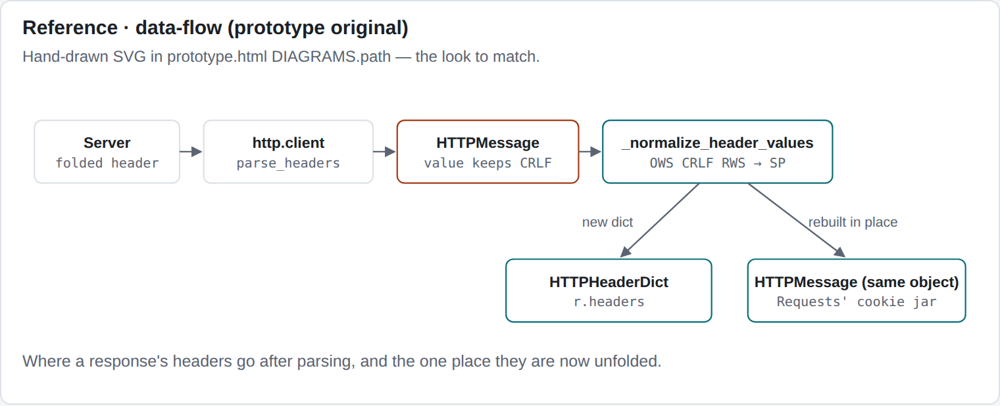
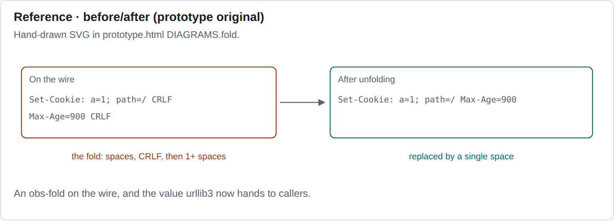

### Flow (six boxes)

B — static SVG, prototype classes, `<>` badges on cited nodes:

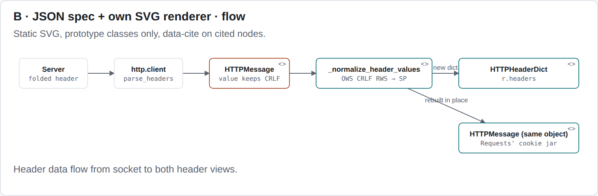

A — note the literal `[diff:…]` text inside labels (the citations gap), lavender default:

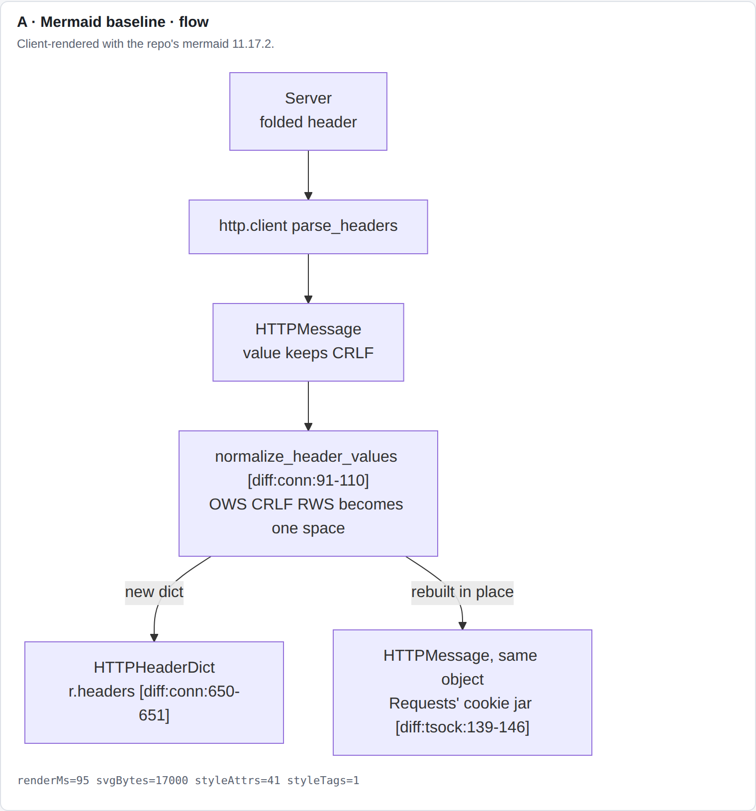

C — dagre auto-layout (the scattered-glyph look in this screenshot is a
stale artifact of the screenshot session, not D2 — correction 2026-10-11:
the identical source re-rendered byte-identical at 15146 bytes and screenshots
cleanly in isolation at 1x and 2x, as does a minimal multi-line test, so the
gallery capture caught the embedded subset fonts before they were ready):

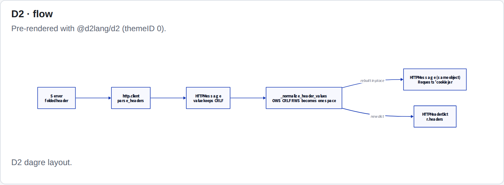

D hand-drawn — Virgil + rough arrows; coordinates hand-placed (note the
`_normalize…` truncation and ad-hoc arrow routing: this is what
agent-emitted coordinates look like without a layout step):

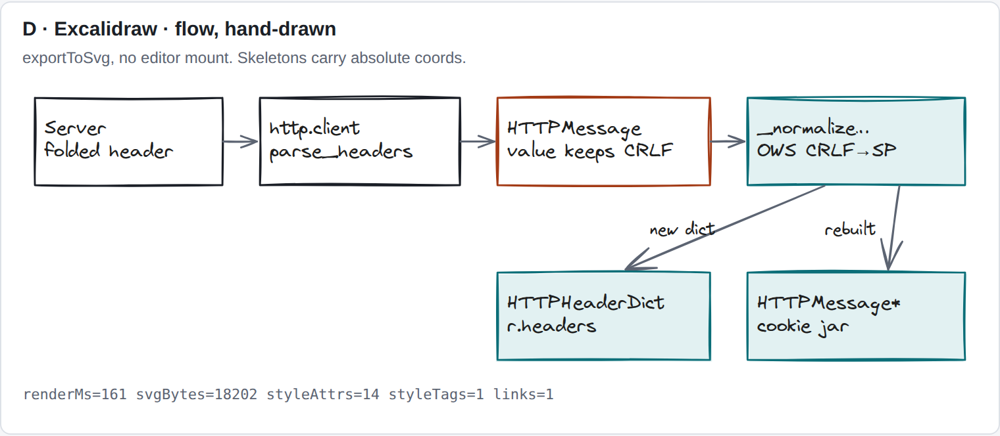

D clean — Helvetica + roughness 0:

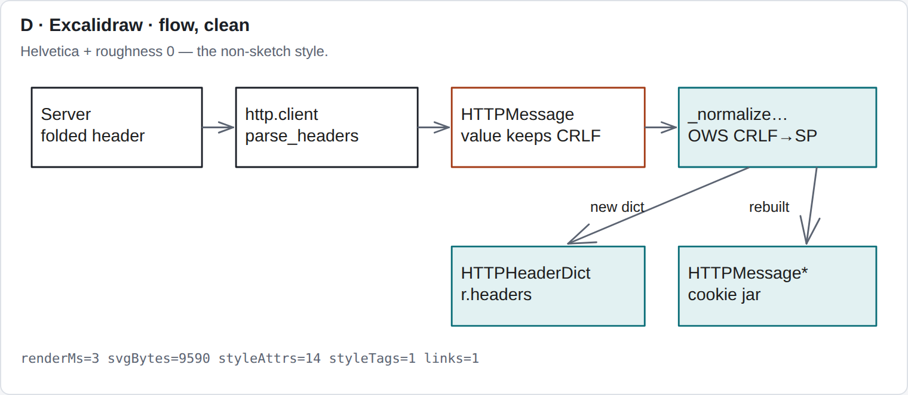

E — dot auto-layout, service-side:

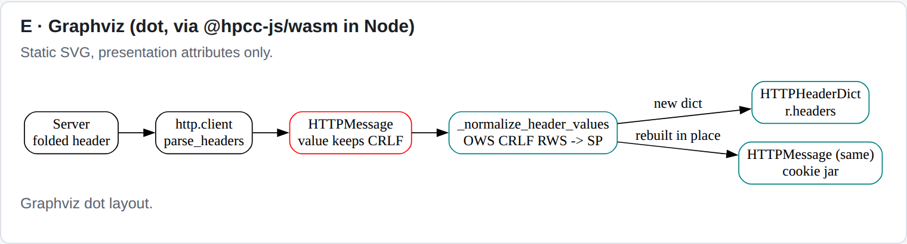

### Before/after (panels)

B (`panels` kind):

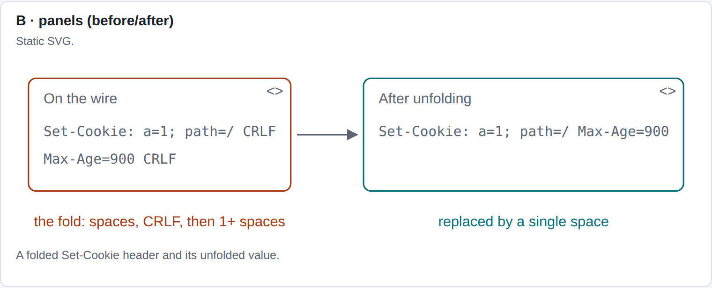

A (Mermaid flow used as before/after, from the fixture recording):

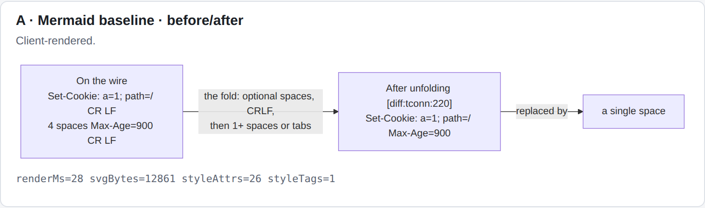

C (before/after expressed as a D2 flow):

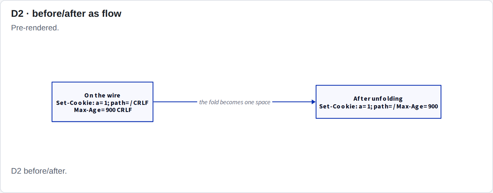

### Sequence (four participants — the harder diagram)

B (`sequence` kind):

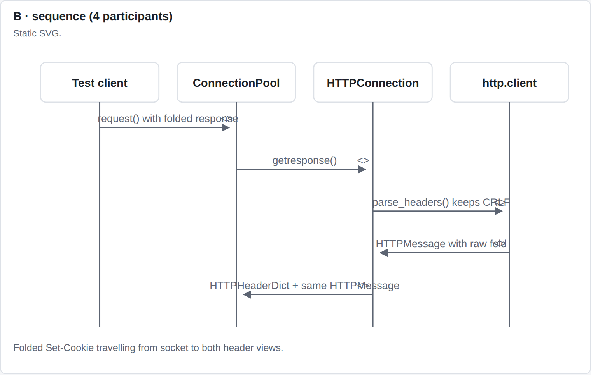

A:

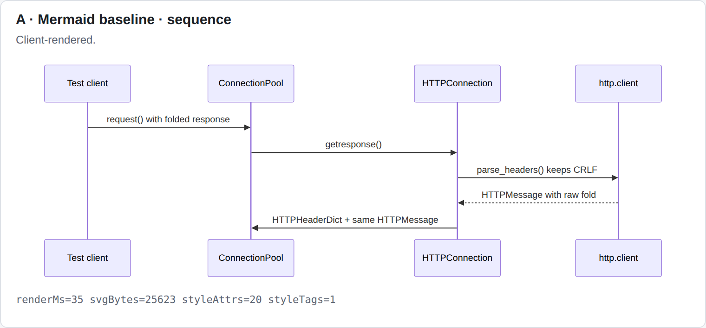

C (`sequence_diagram` shape — the one form where D2 text rendered cleanly):

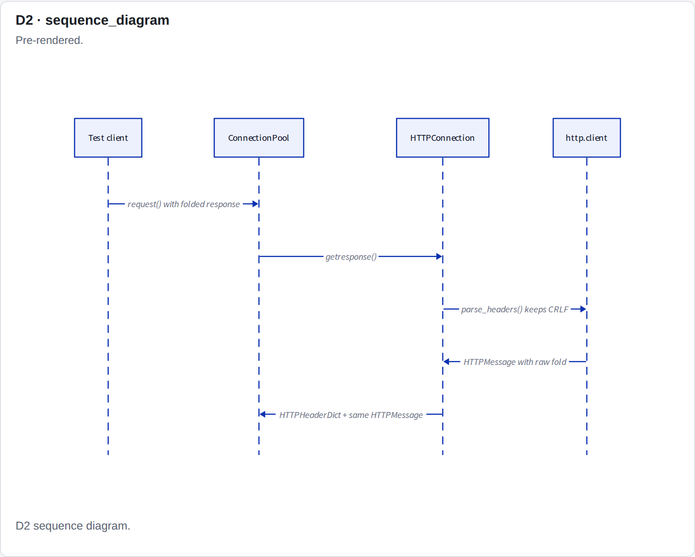

### Dark mode + 400px preview

B flow in dark (inherits vars; D2/Excalidraw/Mermaid dark variants are saved
in `out/` alongside):

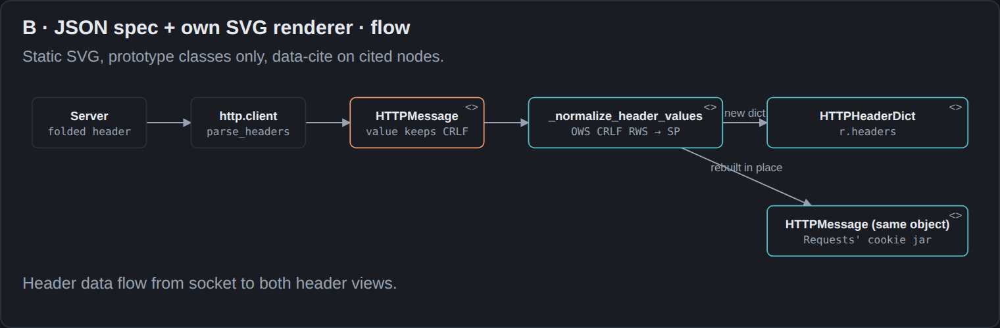

400px hover preview — B scales exactly like the prototype original:

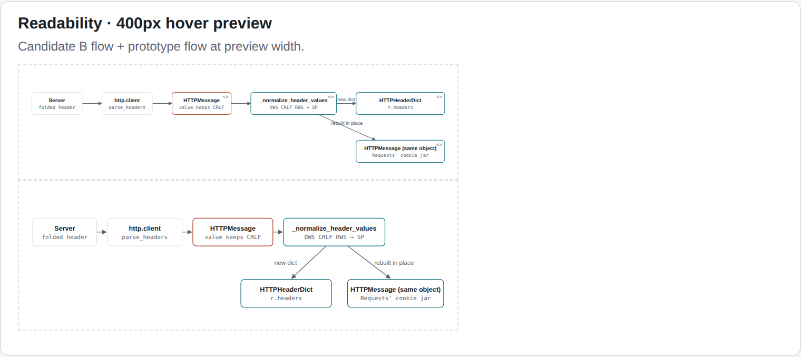

All 60 PNGs (15 sections × light/dark × open/strict CSP) plus
`measurements.*.json` are in `spikes/diagrams/out/`.

## 3. D2 details (candidate C)

- **Official JS package**: `@d2lang/d2` (current; `@terrastruct/d2` is the
  compat alias, same releases). API: `new D2()`, `compile(src, opts)` →
  `{diagram, renderOptions}`, `render(diagram, renderOptions)` → SVG string.
  Worker-backed; layouts `dagre` (default) / `elk` / `tala`; `sketch: true`
  compile option (48 KB SVG for the flow vs 15 KB normal — measured).
- **Themes/dark mode**: `themeID: 0` light / `200` dark verified rendering;
  `darkThemeID` render option exists.
- **Citations**: `link:` on a shape → `<a href>` wrapping it in the SVG
  (verified against `out/d2/links.light.svg`); `tooltip:` feeds an appendix.
  Our tokens are not URLs, so the service must rewrite cites to app URLs
  before compile, and the app must intercept clicks + build hover previews —
  all custom, none of it exists.
- **SVG vs CSP**: every SVG carries a `<style>` block (6 KB+, includes
  base64 `@font-face` subsets — offline ✓, needs `font-src data:` which we
  have) **and** inline `style="…"` attributes (measured 5–6 per tiny diagram).
  Browser execution additionally requires `script-src 'wasm-unsafe-eval'`
  (measured hard failure without it) and `worker-src blob:`.
- **Sequence diagrams**: native `shape: sequence_diagram`, verified.
- **Binary path**: `d2` release tarballs are ~20 MB per platform (GitHub
  release API, v0.7.1). Running it on the service means the user installs a
  20 MB binary (violates "nothing extra to install") or we vendor per-platform
  binaries into the install (adds tens of MB). Rejected for this reason
  before even testing render parity.
- **Licence**: MPL-2.0 for the package including the 42 MB WASM. Flag for
  legal if ever reconsidered; not a blocker for the spike.

## 4. Excalidraw details (candidate D)

From the actual repositories and local runs (page claims checked one by one):

1. **MCP server and CLI offline?** No, for our purposes.
   `github.com/excalidraw/excalidraw-mcp` (`@mcp-demos/excalidraw-server`)
   is a **streamable MCP-Apps demo server** (interactive whiteboard UI pushed
   into chat, Express + Vite), not a "send structure, get SVG" tool; its
   server uploads scene JSON to `https://json.excalidraw.com/api/v2/post/`
   (found in `src/server.ts`), and the recommended setup is the remote
   `https://mcp.excalidraw.com`. The CLI (`github.com/excalidraw/cli`, MIT)
   renders local `.excalidraw` → PNG **locally with no account** (verified
   from its README), but workspace commands need an Excalidraw+ API key
   (`https://api.excalidraw.com`), local render shells out to an installed
   system browser, and CJK hand-drawn text downloads fonts from a CDN on
   first use. Both depend on the hosted service or extra installs.
2. **What the agent sends**: absolute coordinates. The "skeleton" API
   (`convertToExcalidrawElements` from `@excalidraw/excalidraw`, plus the
   `elementSkeleton` types in `@excalidraw/mermaid-to-excalidraw` 2.2.2)
   still requires `x/y/width/height` (and `points` for arrows) as numbers on
   every element — verified in the type definitions and in our gallery
   (`src/excalidraw-skeletons.mjs`, 2416 B of coordinates for six boxes).
   Layout otherwise comes from Mermaid: `parseMermaidToExcalidraw` runs
   Mermaid in-browser and converts its SVG geometry. There is no
   higher-level box-and-edge layout in the OSS pieces.
3. **Read-only static SVG**: yes — `exportToSvg({elements, appState, files})`
   needs DOM but **no editor mount** (verified in gallery). Price: an 8.0 MB
   / 2.43 MB-gzip bundle for that one function (esbuild, minified; the
   editor core is entangled).
4. **Fonts**: 9 families (Virgil, Helvetica, Cascadia, …) ship in the package
   (14 MB) — self-hostable. BUT the default runtime behavior fetches
   `https://esm.sh/@excalidraw/excalidraw@<v>/dist/prod/fonts/…` when local
   assets are missing (measured request, blocked-page test). Override with
   `window.EXCALIDRAW_ASSET_PATH` (verified zero non-local after; note the
   path is a base that `"fonts/…"` is appended to — `["/"]`, not
   `["/fonts/"]`). `exportToSvg` inlines/subsets fonts per render
   (`skipInliningFonts` opts out, at the cost of fallback fonts).
5. **Links**: element `link: string | null` exists in the type
   (`element/types.d.ts:69`) and **exports as `<a>` in static SVG**
   (measured `links=1`, custom `unvibe:` scheme preserved). Skeleton has no
   link field and `convertToExcalidrawElements` regenerates ids by default —
   pass `{regenerateIds: false}` and set links post-conversion (both found
   the hard way). Hover preview wiring is custom app code.
6. **Theme**: `appState.theme` light/dark verified in gallery.
7. **CSP**: 14 inline `style=` + 1 `<style>` per exported SVG (measured) →
   still needs `style-src 'unsafe-inline'`. No `wasm-unsafe-eval`.
8. **`draw_diagram` MCP tool with skeletons**: technically possible (our MCP
   server could accept skeletons, convert, `exportToSvg`), and fully local —
   but the agent must still do layout math, output is 2–5× the bytes of B,
   and rendering costs a 2.4 MB-gzip dependency plus 160–600 ms of main-thread
   font subsetting per diagram (measured). The "agent builds the structure,
   we draw it" slogan holds only if *we* also do layout — at which point the
   structure might as well be B.
9. **Style**: hand-drawn (Virgil + roughness) clashes with the prototype's
   serif/sans quiet boxes (see screenshots). Clean style exists (Helvetica,
   roughness 0 — verified) but then it is just boxes with worse tooling.

## 5. Model reliability (live test)

Method: short prompts built from the fixture's `connection.py` hunk
(`_normalize_header_*`, new-side conn 77–113 and 647–654 named in the prompt),
asking for the header-data-flow diagram in each candidate's format.
Providers: `claude` (Claude Code 2.1.296) and `codex` (0.162.1) CLIs in print
mode, stdin prompts, default models. Counts: **8 generations per candidate
per provider** (A–D), **4 per provider** for E — 72 total, all saved in
`spikes/diagrams/out/rel/` (prompt + raw output + repair outputs).
Validators: A structural in Node + **browser `mermaid.render` of the raw
output**; B `validateDiagram`; C `d2.compile`; D JSON shape check;
E `Graphviz.dot` layout. Citation = range inside conn 77–113 or 647–654.

| Candidate | Claude first-try valid | Codex first-try valid | Valid after 1 repair | Cites correct (both) |
|---|---|---|---|---|
| A Mermaid (structural) | 8/8 | 8/8 | — (never triggered) | 16/16 |
| A Mermaid (**actually renders**) | **8/8** | **1/8** | Claude 1/1 (render-verified); Codex 0/1 (echoed broken diagram) | 16/16 present, 7/8 Codex unrenderable |
| B JSON spec | 8/8 | 8/8 | — (no failures) | 16/16 |
| C D2 | 8/8 | 8/8 | — (no failures) | 16/16 |
| D skeleton | 8/8 | 8/8 | — (no failures) | 16/16 |
| E dot | 4/4 | 4/4 | — (no failures) | 8/8 |

The A/Codex failure has one sharp cause, confirmed by diffing the passing vs
failing outputs: a cite token `[[diff:…]]` inside an **unquoted** node label
(`E[…r.headers<br/>[[diff:conn:650-651]]]`) makes Mermaid read the token's
`[` as shape syntax → `Parse error … Expecting 'SQE'…`. The identical token
inside a **quoted** label (`E["…[[diff:conn:650-651]]"]`) renders fine. Whether
labels get quoted is model formatting chance the prompt does not control —
Codex quoted some labels and not others in the same diagram. Consequences:

- Mermaid validity is a coin-flip **iff** citations are included — which is
  the whole point of diagrams here. Without tokens, Mermaid is as reliable
  as anything (16/16 structural).
- The repair loop for Mermaid spends its one turn on bracket quoting, and
  Codex did not apply the fix when asked (n=1).
- Service-side pre-validation of Mermaid is weaker than it looks:
  `mermaid.parse` in Node catches the lex-stage error, but **any realistic
  diagram (labels with `<br/>`) throws `DOMPurify.addHook is not a function`**
  in pure Node (measured) — full validation needs a DOM (jsdom weight or a
  browser), unlike B/C/D-shape/E which validate in plain Node today.

B/C/D/E never failed in 72 generations, so their repair turns are untested
live; all four validators were separately proven against broken inputs
(unknown edge endpoint, `a -> -> b`, `digraph { a -> }` all caught with
actionable messages — the error strings a repair turn would receive).

## 6. Adoption plan for B (if accepted)

Rough size: ~1 week, mostly the renderer component + prompt/pipeline
plumbing. Files in order:

1. `packages/shared/src/content/` — extend the block model: `DiagramBlock`
   gains `{ spec: DiagramSpec }` beside `mermaid` (keep Mermaid parsing for
   old replies). New file `diagram-spec.ts`: the `validateDiagram` logic
   from the spike (~150 lines, no deps). Parser change: ` ```diagram-json `
   fence → `DiagramBlock` + collect `cite` fields into block citations
   (same `tokenizeLinks` path as mermaid labels today). (~100 lines.)
2. `packages/service/src/validate/validate.ts` — validate the spec
   (structure + cite ranges via the existing citation validator; ranges
   off-by-a-few-lines reuse the auto-repair path from §10). One repair turn
   reuses the existing "several citations fail" follow-up. (~80 lines.)
3. `packages/web/src/guide/DiagramSvg.tsx` (new, ~150 lines, replaces
   `MermaidSvg.tsx` for new blocks): render `renderDiagramSvg(spec)` output
   via `dangerouslySetInnerHTML`, bind `[data-cite]` to the existing hover
   preview + click-to-reveal handlers, keep the source-fallback on error.
   Port `src/render.js` (~250 lines) to TS, import prototype CSS as-is (no
   new styles needed — that is the point).
4. `prompts/diagram.md`, `prompts/go_deeper.md`, `prompts/explain.md`,
   `prompts/instructions.md` (reply-format section) — fence name, schema,
   caps, `col` hints, bare-form cites. Prompt golden tests updated.
5. `fixtures/urllib3-5020/recordings/diagram-*.md` — re-record the two
   diagram fixtures in the new format (the replay runner + behaviour tests
   consume them).
6. CSP: keep `style-src 'self' 'unsafe-inline'` only until the last Mermaid
   diagram ages out, then drop `'unsafe-inline'` for styles — the first
   candidate that lets the policy get *stricter*.

## 7. Addendum 2026-10-11: decision is D2 with a user-installed binary

**Decision:** adopt candidate C (D2), with the `d2` binary required on the
user's machine and all rendering done service-side. This kills the two worst
D2 findings outright: no browser bundle (was 8.4 MB gzip) and no
`wasm-unsafe-eval` (browser WASM is out of the picture). MPL-2.0 largely
evaporates as a concern: we shell out to a user-installed program, never
bundle the WASM. Honest remainder: D2 SVGs still carry `<style>` blocks and
inline `style=` (11 attrs + 2 blocks on a 4-node test), so
`style-src 'unsafe-inline'` stays — no worse than Mermaid today.

**Binary findings, verified hands-on with d2 v0.9.0** (17 MB tarball,
downloaded, tested, removed; ~9 ms compiles):

- All cite forms survive compilation byte-identical inside quoted strings —
  `link: diff:conn:80-88`, `link: "[[diff:conn:91-110]]"`, and marker-style
  `link: unvibe:cite:1` — each emerging verbatim as `<a href="…">`. The
  Mermaid `[`-in-label failure mode does not exist here; D2 quoted strings
  are opaque to the layout engine.
- `tooltip:` renders as native `<title>` (dumb browser hover text).
- Fonts are base64-embedded subsets in CLI output too (1 `@font-face` on the
  test) — fully offline, no system-font dependency.
- `--theme 200` renders a genuinely different dark SVG (man source also
  documents `--dark-theme`, `--sketch`, `--scale`, `--font-*` TTF overrides).
- The glyph-spacing artifact in §2's gallery screenshots was proven
  environmental (stale font state in the capture session, see correction
  above), not a D2 defect: the identical source re-rendered byte-identical
  (15146 bytes) and screenshots cleanly at 1x and 2x in isolation.

**Refined citation design (no sidecar):** the agent writes the cite directly
on the node — `link: "diff:conn:80-88"` — single channel, one prompt line.
Service pipeline: (1) extract `link:` values from source (verbatim by
construction), (2) validate each as a cite token with the existing validator
(ranges, auto-repair — the standard path), (3) compile-check via the binary,
either failure → one repair turn, (4) render light + dark, rewrite each
`href="diff:conn:…"` to the app URL in the SVG string, (5) strip `<title>`
elements containing token patterns so native tooltips don't fight the app's
rich hover preview (don't teach `tooltip:` in prompts).

**Build order:** mini reliability run on the `link:` convention first (~16
generations, spike harness exists — the convention is new and untested);
then binary discovery + `doctor` (login-shell PATH, `d2 version`, minimum
version gate — D2 is 0.x and drifts); render cache keyed by content hash;
web renderer (inline cached SVG, delegate `<a>` clicks, existing hover
previews, source fallback when binary missing); prompts + fixtures +
golden tests; keep Mermaid renderer until stored replies age out. Rough size
3–5 days. Subprocess hygiene throughout: source via stdin only, timeouts,
byte caps.

**Risks, ranked:** (1) version drift across user machines — validate and
render with the same binary, gate min version in doctor; (2) D2 0.x syntax
stability — compile-check converts breakage into repair turns; (3) the
`link:` convention itself is unproven with models (the gate in the previous
paragraph); (4) playground extras (boards/layers/scenarios/steps) are
deliberately out of scope — layers noted only as a future escape hatch for
before/after diagrams.

## 8. Addendum 2026-10-11: reladraw (candidate F, evaluated after the table)

[reladraw](https://github.com/reladraw/reladraw) (v0.16.0, Apache-2.0,
~1100 stars): a relative-placement text language ("right of X", no
coordinates, no auto-layout) with a zero-dependency TS parser/layout/renderer
(647 KB npm package, ~90 KB gzip est. browser cost). Evaluated hands-on:
our flow reference rendered cleanly, `url:` on nodes and edges emits
`<a href>` (verified), output is strict-CSP clean (0 style attrs/tags),
14 built-in themes, CLI exit codes with errors that name the statement.
Agent spot check with a condensed 1.2 KB syntax prompt: 4/4 valid first-try
(2 Claude + 2 Codex), all cites in range — notable given the author states
models haven't seen the language (a 131 KB `llms-full.txt` + skill exists
for that reason).

**Gaps for us:** no sequence diagrams (placement language, no native form —
our "harder" reference has no expression); prompt cost (complex features
likely need the full syntax doc in context, ~30× our spec's prompt weight,
per diagram); language unstable pre-1.0 with PRs not accepted (pinned to a
moving target we can't contribute to); style has no semantic states and a
hardcoded monospace aesthetic; themes bake in at render time (re-render for
dark mode, cheap but app-driven).

**Standing:** strongest fallback if D2 adoption fails — it collapses syntax,
validator, and renderer into one maintained dependency and scores well
everywhere except sequences and prompt cost. Not pursued while D2 proceeds.
...[truncated 2086 chars]