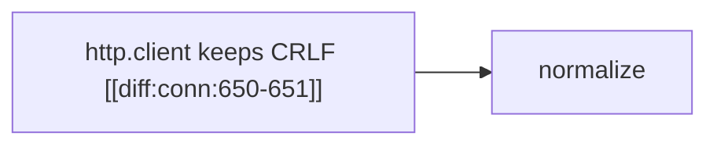

# Agent reply format (normative)

Agents write **Markdown with inline link tokens** and end the reply with
**one fenced JSON block** for structured fields (PRD §10). The app removes
the JSON block before display. Implemented in
`packages/shared/src/content/`; validated in
`packages/service/src/validate/`.

## 1. Inline link tokens

Write citations and links inline as `[[…]]` with an optional `|label`:

```
…the helper replaces each fold [[diff:conn:80-88]] with a single space.
…see [[concept:obs-fold|obsolete line folding]] and [[page:f-lf|the bare-LF finding]].
```

| Token kind | Meaning | Rendering |
|---|---|---|
| `[[diff:<fileKey>:<start>-<end>]]` | New-side lines in the change | Citation marker (`<>`) at the end of the block |
| `[[code:<path>:<start>-<end>]]` | Code at a commit | Citation marker |
| `[[desc:<paragraph-id>]]` | PR description paragraph | Citation marker |
| `[[h:<fileKey>:<contentHash>]]` | A hunk | Citation marker |
| `[[concept:<slug>\|label]]` | Concept (unknown slugs become hidden candidates) | Dotted inline link |
| `[[page:<pageId>\|label]]` | A page | Dotted inline link |
| `[[card:<cardId>#<blockId>\|label]]` | Guide content | Dotted inline link |
| `[[ann:<id>\|label]]` | An annotation | Dotted inline link |

Rules:

- A citation token's display text is its label if given (`[[diff:conn:80-82|the pattern]]`
  shows "the pattern"), otherwise nothing — never invent a line quote.
- Line ranges must lie inside one hunk; ranges off by a few lines in the
  same hunk are repaired automatically, the rest are shown dimmed as
  **unverified**.
- Inline code uses backticks and is preserved: `` `HTTPMessage` ``. Tokens
  inside backticks or fenced code blocks are literal, never citations.
- Short forms (`[[diff:conn:82]]`, `[[desc:d-intro]]`) may drop the
  `@<sha>`/`@<rev>` suffix; stored references keep it.

## 2. Cards

`## Title` starts a new card. Text before the first `##` is one untitled
card (normal for single-card replies: explain, ask, depth, examples,
diagram). Titles are plain text — no tokens.

```md
## The problem

Python's `http.client` keeps the folded value … [[desc:d-intro]]

## The central change

urllib3 now unfolds … [[diff:conn:91-110]]
```

## 3. Per-depth text (simple / standard / deep)

The paragraph itself is the **standard** version. Simpler and deeper
variants go in `::: simple` / `::: deep` containers **immediately after**
the paragraph they rewrite:

```md
The pattern finds "spaces, line break, spaces". [[diff:conn:80-82]]

::: simple
The code searches for "optional spaces, a line break, then at least one space".
:::

::: deep
Regex engines that backtrack retry at each start position …
:::
```

At the deepest level, `+` may add an `::: underlying-principle` block
(`::: principle` also works).

## 4. Examples and asides

```md
::: example
`Set-Cookie: a=1` stays separate from `b=2`.
:::
```

`::: example`, `::: diagram`, `::: principle` (or
`::: underlying-principle`) become the Example / Diagram /
Underlying-principle inserts. Inner content is ordinary Markdown.

## 5. Diagrams

Diagrams are fenced `mermaid` blocks (PRD §13/§19.4). Citation tokens are
allowed in node labels. An optional `Caption: …` paragraph right after the
fence becomes the caption:

````md


Caption: Where response headers go after parsing.
````

## 6. Follow-up suggestions

A `### Follow-ups` heading turns the list after it into follow-up
suggestions. Each item is `Label` or `Label | ask: pre-baked question`:

```md
### Follow-ups

- What happens to a fold that ends in a bare LF? | ask: bare lf
- Does unfolding change header order?
```

## 7. Finding references

A paragraph holding exactly `Finding: [[page:<finding-page>]]` renders as
the orange finding reference card:

```md
Finding: [[page:f-lf]]
```

## 7b. Suggested-comment links

Finding pages link their drafted suggested comment with a `comment-link`
block (PRD §4.9): hover previews the thread, click jumps to the diff line.
The block is constructed by the app (pipeline/builder) from the critic's
trailing-JSON `suggestedComment`, not written by the agent — there is no
inline text form. It renders as `Comment: [[ann:<thread>]] [[<diff:…>]]`.

## 8. Tables and lists

GitHub Markdown tables and `-`/`*`/`1.` lists. Every table cell and list
item supports inline code and tokens; a list item's citations attach to
the item, and the block carries the union.

## 9. Finding metadata and other structured fields

Evidence, assessment prose, and concept stubs live in the Markdown body.
Metadata goes in the trailing JSON block:

```json
{
  "title": "Folds that end in a bare LF are not unfolded",
  "finding": {
    "confidence": "medium",
    "summary": "http.client accepts LF-only line ends, but the new code looks for CRLF.",
    "suggestedComment": {
      "text": "Would `\\r?\\n` here, plus a test, make sense?",
      "diff": "diff:conn:82"
    }
  },
  "concepts": [
    {"slug": "obs-fold", "title": "Obsolete line folding", "summary": "…"}
  ],
  "pendingCards": [
    {"id": "g-flow", "label": "Data flow …", "why": "Follows a folded header …"}
  ],
  "contribute": {
    "facts": [{"text": "…", "citations": ["diff:conn:82"]}],
    "corrections": [{"text": "…", "target": "card:central#b2"}],
    "open_questions": ["…"],
    "reader_notes": ["…"]
  },
  "hunk": {"summary": "…", "hiddenReason": "imports"},
  "depth": {"level": "simple", "cardId": "central"},
  "anchor": {"quote": "raw CRLF", "host": "card:problem#b1"},
  "secondOpinion": {"verdict": "agrees", "reasoning": "…", "missed": "…"}
}
```

All fields are optional; unknown fields are kept, never rejected. For
depth/example/diagram replies, `depth`/`title` say which card and level
the body belongs to. For hunk-pass replies, `hunk` carries the summary
and the one-line `hiddenReason` (null when the hunk is interesting — in
particular never hide a hunk cited by the guide, a one-line functional
change, or anything unsure).
The `anchor.quote` must be a real substring of its host block.

## 10. The trailing JSON block

- It is the **last** fenced block in the reply, tagged `json` (or
  untagged). Earlier fences (code examples, Mermaid) are content.
- Trailing whitespace and non-fence prose after it are ignored.
- A missing block is fine for replies with no metadata. A `json`-tagged
  fence that does not parse, or parses to a non-object, is an error.
