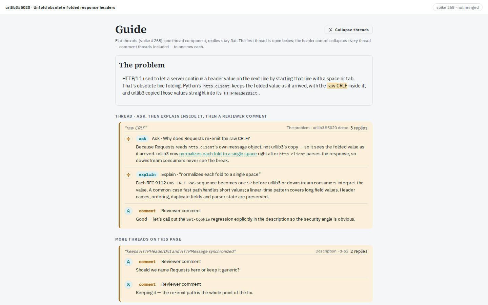
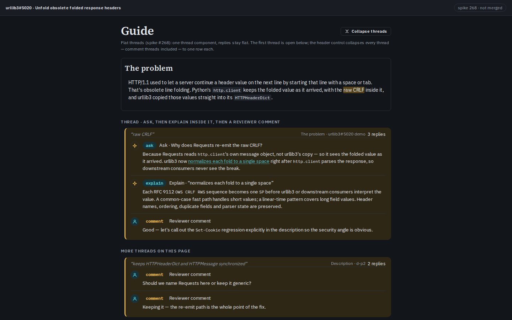
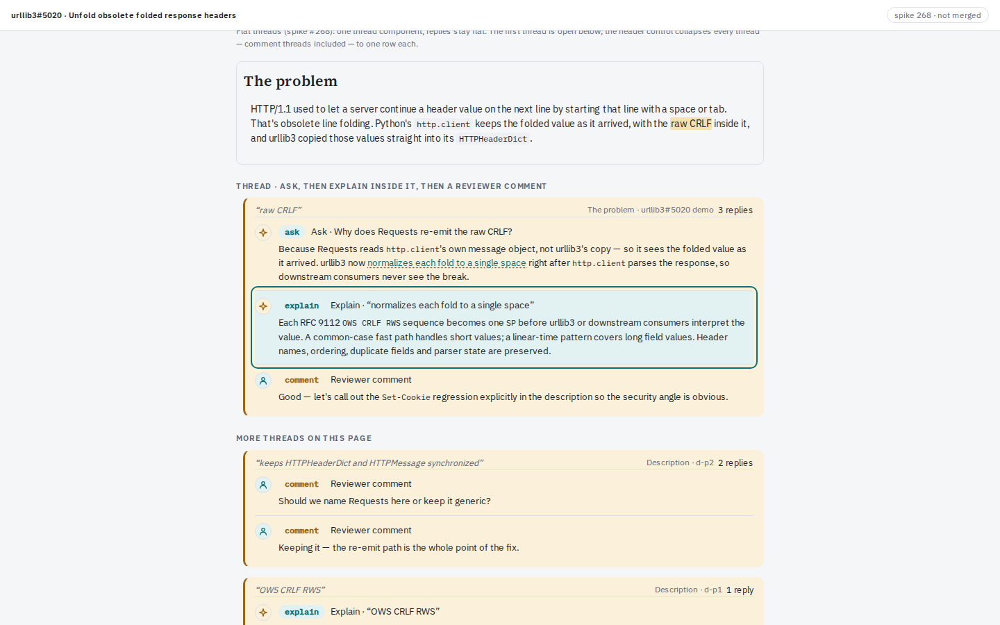
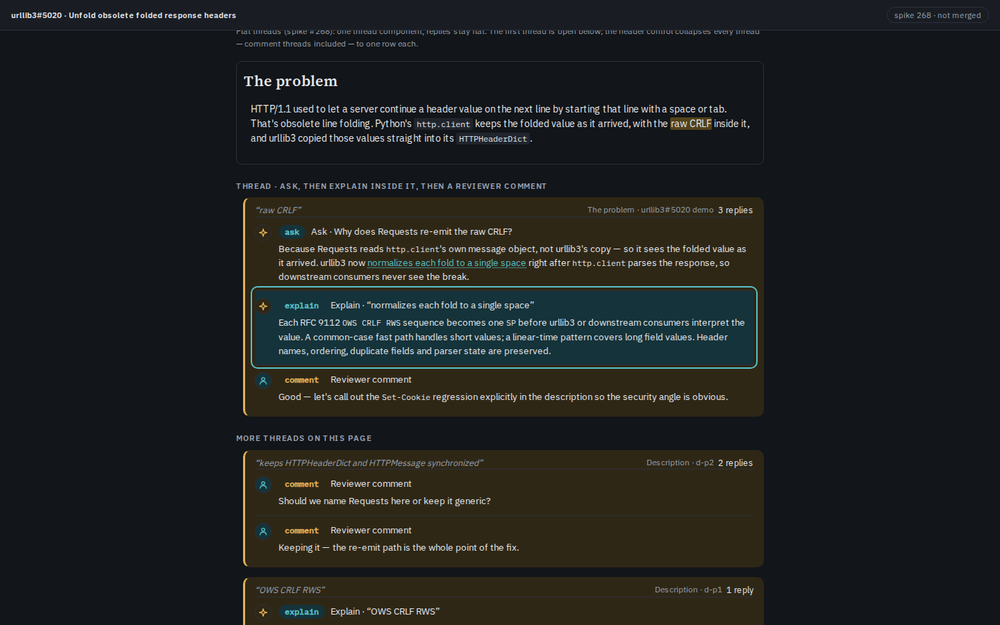
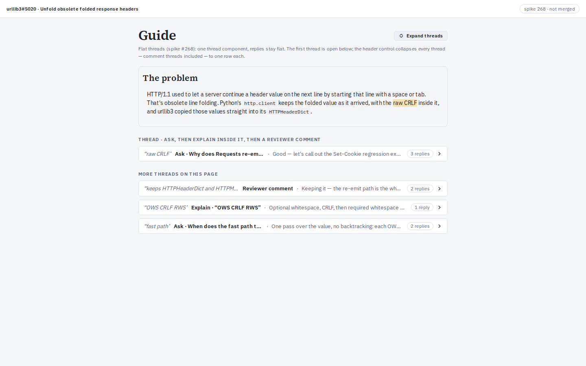
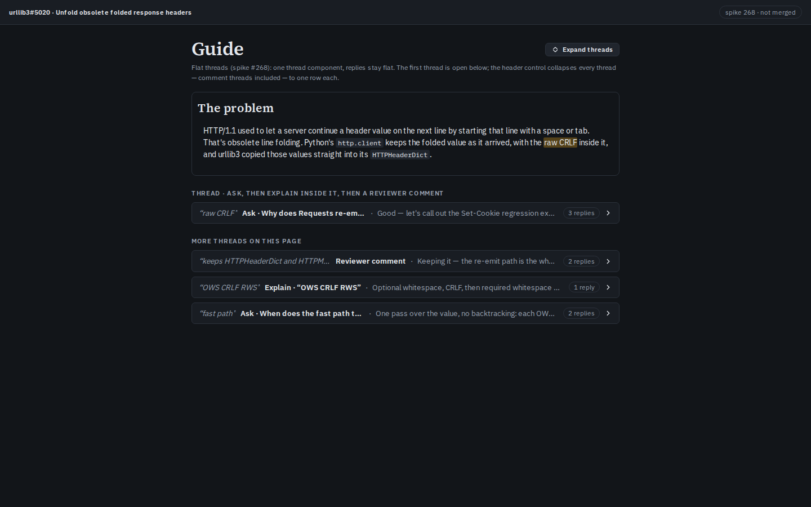
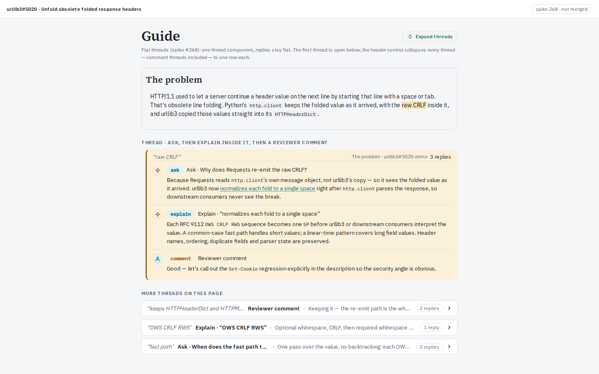
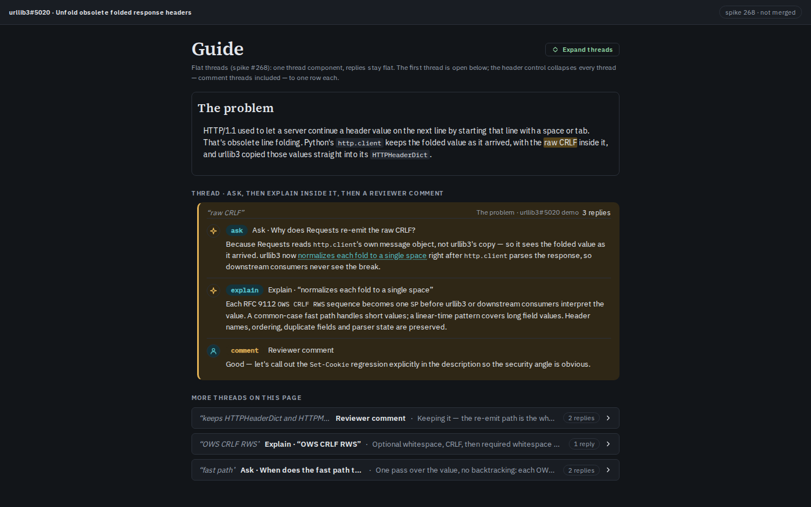

# Spike #268: flat threads — mock-up + data-model proposal

Branch `spike/268-threads` — **never merged**. Spike-only page, harness and
screenshots live together here. No production changes.

How to run the mock-up: from `packages/web`, `VITE_MOCK=1 npx vite
--port 5431 --strictPort --host 127.0.0.1`, then open
`/spike/268-threads` (`packages/web/spike268-shots.mjs` captures every
screenshot below). Route registered in `packages/web/src/App.tsx` on this
branch only.

## What the mock-up shows

One thread component for everything. A thread is anchored once (a guide
card excerpt, the description, the diff); its answers are flat replies in
that thread — never boxes nested inside boxes. Reply kinds are visible:
agent answers (`ask` / `explain`, spark avatar) vs reviewer comments
(`comment`, person avatar). Hyperlinked text inside a reply scrolls to its
target reply in the same thread and highlights it. The guide pane header
carries one "Collapse threads" control that collapses **all** threads,
comment threads included, to one-line rows (anchor quote · first question
· latest-answer snippet · reply count). Expanding a row restores its
thread.

### The thread: an Ask, an Explain inside it, then a reviewer comment

The featured thread is anchored on "raw CRLF" in "The problem" (real
urllib3#5020 demo text). Reply 1 is the Ask answer; the hyperlinked phrase
"normalizes each fold to a single space" points at reply 2, the Explain
answer. Reply 3 is a reviewer comment.




960-wide variants: `thread-960-light.png`, `thread-960-dark.png`.

### Reply link in action

Clicking the hyperlinked text scrolls reply 2 into view and highlights it
(teal outline, ~2.4 s). Frame taken after the click:




960-wide variants: `replylink-960-light.png`, `replylink-960-dark.png`.

### Collapsed view: one row per thread

Header control collapsed every thread on the page (three comment-thread
replies and two agent threads among them) to one line each:




960-wide variants: `collapsed-960-light.png`, `collapsed-960-dark.png`.

### One row expanded again

Clicking the first row restores its thread; the rest stay collapsed:




960-wide variants: `one-expanded-960-light.png`,
`one-expanded-960-dark.png`.

## Proposed data model

**Today (nested expansion tree).** Annotations live in
`packages/shared/src/entities.ts` (`Annotation`, ~100 lines: `Turn`,
`ChatMessage`, `Anchor`, `AnchorHost`) and ride
`ReviewSnapshot.annotations` (`packages/shared/src/api.ts`), persisted as
JSON inside `review_snapshots.snapshot` (SQLite,
`packages/service/src/store/migrate.ts`, migration 001 — no tables for
threads). Nesting is addressing, not structure: the list is flat, but an
Explain/Ask on text inside a conversation answer creates a *new*
annotation whose `anchor.host` is `{kind:"block", blockId:"<ansId>#<block>"}`
— the hosting answer's id qualifies the block. Rendering recurses:
`ExpansionCard` → `AnswerView` → `expansionsForBlock` → `ExpansionCard`
(`packages/web/src/guide/expansions/`, with an `ancestorIds` cycle guard),
fed by DOM mark passes (`ExpansionHighlights.tsx`, `GuideThreads.tsx`).
Comments live in the *same* `annotations` array (`type:"comment"`,
`messages: ChatMessage[]`, Outbox `post`/`draft`) but render through a
separate component (`comments/ThreadView.tsx`) with separate affordances;
conversations can also anchor *on* comments (`host kind:"comment"`, #214).
Depth/examples/diagram/undo/second-opinion act on `ContentBody`
(card bodies *and* answer bodies via `ans_…` ids, #136), so per-answer
controls assume the nested address.

**Proposed (flat threads with replies).** One entity:

```ts
interface Thread { id: string; anchor: Anchor; replies: Reply[];
  open: boolean; post?: boolean; draft?: string; reply?: string | null;
  working?: string | null; error?: string | null; jobId?: string;
  outdated?: boolean; successor?: Anchor; postedAt?: number; }
type ReplyKind = "ask" | "explain" | "comment" | "persona"; // persona later (#11)
interface Reply extends ContentBody { kind: ReplyKind; who: "agent" | "you";
  question: string | null; linkTo?: string /* in-thread reply id */ }
```

The anchor stays as-is (block/description/diff-line/hunk/code/comment
hosts all still work); only the `ans_…` host form dies with nesting.
Explain/Ask-on-content creates a thread whose first reply is the answer;
Explain/Ask *inside* a thread appends a reply instead of a child
annotation. In-thread hyperlinks are `linkTo` reply ids, not anchors:
click scrolls + highlights, no patch, no job. Depth/second-opinion keep
acting on reply bodies (same `ContentBody` lookup by reply id).
**Comments merge in:** today's `messages[]` become `replies[]` with
`kind:"comment"`; `post`/`draft` move to the thread; submit/lease/outbox
read comment-kind replies. Stored shape changes → **wipe the data dir, no
migration** (no back-compat per repo rule).

## What it would replace

- `packages/shared/src/entities.ts` (~1180 lines): `Annotation`/`Turn`/
  `ChatMessage` → `Thread`/`Reply`; `AnchorHost` loses the `ans_…` form.
- `packages/shared/src/api.ts` (~1550 lines): `ReviewAction`
  explain/ask/reply/retry/followup/promote payloads; comment
  create/reply/PATCH types; WS patch paths under `/annotations`.
- Service pipeline: `pipeline/actions/conversation.ts` (~900, turn fill +
  session), `followup.ts`, `explain-host.ts`, `promote.ts`
  (+`promotedTurns`), `interaction/cards.ts` (`CardTarget` incl. answers),
  `sessions/` (per-annotation session → per-thread).
- Service comments/submit: `comments/threads.ts` (~630),
  `comments/location.ts`, `submit/*` (lease keyed by thread id).
- Web: `expansions/ExpansionCard.tsx` (~520, recursion + ancestorIds),
  `expansionUtils.ts`, `ExpansionHighlights.tsx` (~335, mark passes),
  `CardView.tsx` open-card branch, `DiffExpansions.tsx`,
  `DescriptionExpansions.tsx`, `comments/ThreadView.tsx` (~280),
  `GuideThreads.tsx` (~385), `CommentsMenu.tsx`, `NewThreadComposer.tsx`,
  `floating/SelectionToolbar.tsx` (anchor forms), `mock/index.ts` seeds.
- Prompts: `ask.md`, `ask_turn.md` (follow-up session history assembly).
- Tests/journeys rewritten against the real service (no new mock specs):
  j2-explain-ask, j15-multi-turn, j214-explain-in-comment,
  j265-expand-up, j266-scroll-restore, j206-anchor-blink,
  j6-restart-mid-answer + ExpansionNesting/ThreadView/GuideThreads/
  CardViewPromoted suites.
- Store: no new tables; `review_snapshots.snapshot` JSON shape changes.

A few lines, not a plan: land the types first (`packages/shared`), then
service actions + session scoping, then one web thread component replacing
`ExpansionCard` + `ThreadView`, then submit/lease, then journeys.

## Open points for the owner before a build

1. Where does an anchored thread render (inline under its card as today,
   or a threads section)? Mock shows inline under the card.
2. How do depth / underlying-principle / second-opinion attach — per reply
   (mock) or per thread?
3. Stored-data reset: shape change wipes reviews — acceptable when?
4. Collapsed-row content: question vs anchor quote first, snippet length,
   reply-count wording — mock shows all four, confirm.
5. Persona notes (#11) as the fourth reply kind — in scope for the build
   or later?
