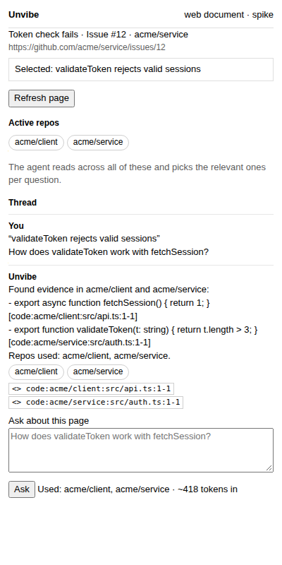

# Spike #322 part 2 — side panel, one thread per page, multi-repo answers

Status: **spike on `spike/322-side-panel`, never merged.** Part 1 (PR button,
extension-origin allowlist, `/open`) is on `main-rc`. This spike proves the
panel shape and the multi-repo read; it is not the production build.

**Pilot result (run first, per the pilot rule): PASS.** Two fixture repos —
`acme/service` (holds `validateToken`) and `acme/client` (holds
`fetchSession`) — one question mentioning both symbols. The retriever's read
log contains files from **both** worktrees, the repos-used list is
`[acme/service, acme/client]`, and citations are repo-qualified for both.
Test: `packages/service/test/panel-322.test.ts` (2 cases). If this had failed,
the rest would not have been built.



## What the prototype does

- `chrome.sidePanel` panel (`extension/panel/`) opens from the toolbar action
  on github.com pages. It shows the captured page, the active repos, and
  **one thread keyed by page URL**.
- Selecting text is captured (with title/URL and a capped context window)
  only when the panel asks; Ask sends it. Answers render with repo chips
  (every repo used) and `<>` citation chips.
- The service stands in for the agent turn with a deterministic read-only
  retriever (no live tokens). It reads across all active repos, so the
  multi-repo selection evidence is real file reads, not a prompt claim.

**Spike shortcuts (production must not keep them):** the panel is vanilla
JS, not the app's React thread component; threads live in
`<dataDir>/spike-322-panel.json`, not as real reviews; the retriever is
keyword search, not an `AgentRunner` turn; the side-panel page is loaded
directly in the Playwright journey because headless Chromium cannot open
side-panel chrome UI.

## 1. Multi-repo lockdown and tool scoping

- **Active repos** = a Settings list the user maintains (spike: stored repo
  ids, default the 3 most recently opened remembered repos, via
  `GET/PUT /api/extension/panel/active-repos`). Only repos with a local
  checkout can be active.
- **Naming:** a repo is `owner/name` everywhere — tool calls, citations,
  UI chips. Citation grammar extends `code:` with the slug:
  `code:acme/service:src/auth.ts:12-18` (slug has one `/`, no colon, so the
  path splits unambiguously from the right). Parser:
  `parseRepoCodeCitation` in `packages/shared/src/webdoc.ts`.
- **Lockdown (carries to production):** every read resolves with
  `realpath` and must stay inside an active repo's worktree
  (`assertInsideRepo`); `.git`, `node_modules`, `dist` are skipped; files
  over 200 KB and binary files are not read; caps on files walked and hits
  per repo. Read-only always — the panel never gets the full-access posture
  (#160 does not apply), no shell, no `git`/`gh`, no network from the turn.
  In production the same boundary is the pi extension's worktree guard,
  generalised from one `UNVIBE_PI_CWD` to an allowlist of roots, with the
  repo slug prefixed to every tool result so the model cannot confuse
  same-named files in different repos.
- **Repo not active:** the answer says so plainly ("No matches in the
  active repos … Add the repo to Active repos") and names the active set.
  It never reads outside the list to be helpful, and never guesses.
- **Selection:** the agent may use several repos in one turn; a repo counts
  as *used* only when cited. The panel lists exactly the cited repos.

## 2. The web-document model

- **Captured, only on Ask/Explain:** URL, title, the user's selection
  (≤2,000 chars), and a window of main text (≤8,000 chars). Nothing on
  page load, no background scraping, no third party: page text goes only
  to the local service, quoted as untrusted input in the prompt.
- **Storage (production):** a `web` review kind like document reviews
  (#222) — the captured page is the document, blocks get stable ids,
  threads anchor to quoted page text (`web#…`). Staleness: the capture
  hash is stored; if the page's text changes, anchored quotes that no
  longer match show as footnotes, as document anchors already do.
  SPA/canvas pages (Google Docs) give no usable text — capture returns
  empty and the panel says so instead of inventing context.
- **Token/cost per question:** capture ≈2.5k tokens in (8k chars context +
  selection), plus repo evidence; one normal agent turn on the configured
  small model (consider muse-spark). No background calls. The spike panel
  shows the estimate returned by `/ask`.

## 3. Extension–service protocol

- Only the background worker calls the service (as part 1). Content
  scripts and the panel page never hold the token; the panel messages
  the worker (`unvibe:panel-*`), the worker reads the `__unvibe_token`
  cookie and sends it as Bearer, loopback only.
- Endpoints (all under the exact allowlisted extension origin, token
  still required; unknown extension origins get 403, tested):
  `GET /api/extension/panel/active-repos`, `PUT …/active-repos`,
  `GET …/panel/thread?url=`, `POST …/panel/ask`.
- Scope guard: non-github.com page URLs are refused (400) in the spike.

## 4. Open questions for the owner

1. Default active repos: most-recent 3 (spike choice), all remembered,
   or ask on first use?
2. Model for panel turns: the small pick, or muse-spark regardless?
3. Should web-document threads appear in the app's Reviews list
   immediately, or only after the first question?
4. Citation click in the panel: open the app at that file/line (spike
   shows the citation text only) — worth it in v1?
5. Page-change handling: silent re-anchor, or tell the user the page
   changed since the thread started?

## 5. Recommended build plan (sizes)

| Piece | Size |
|---|---|
| `web` review kind + capture storage + staleness | M |
| Multi-root lockdown in the pi extension + slug-prefixed tools | M |
| Real agent turn for panel asks (streaming, citations validated) | M |
| React panel reusing the app thread component | M |
| Settings UI for Active repos | S |
| Generalise beyond github.com (+ SPA/canvas detection) | M |

## Verify

```sh
npx vitest run test/panel-322.test.ts --root packages/service   # pilot
npx playwright test e2e/extension-panel-322.spec.ts             # in packages/web, after `mise run build`
```

Journey evidence: the committed frame above (`panel-frame.png`, panel
answering from `acme/service` + `acme/client`).

**Environment note (honest):** on this shared machine, headless Chromium
will not load any unpacked extension — part 1's journey
(`extension-322.spec.ts`) fails here the same way (button never appears),
pre-existing and unrelated to this spike. So `extension-panel-322.spec.ts`
could not go green here; it is written to the same pattern as part 1
(plus dropping Playwright's default `--disable-extensions`, which any
unpacked-extension spec needs) and should be run where part 1 passes.
The frame was captured with the real panel page, real worker-shaped
messages and the real service; only the `chrome.runtime` transport was
proxied, because the extension itself cannot load in this environment.
